  
  

## Hey, I’m Chase 👋

Developer since 2018. Proud owner of the very creative username **ChaseStruse**. Still loving (almost) every minute of writing code.

I work with **Python and AWS**, explore **Python and Swift** in my free time, and am always up for building something with other people.

Away from the keyboard? Basketball, video games, and pretty much anything nerdy. **Huge Boston Celtics fan** — bring up the Celtics and we might be here a while. ☘️

## My toolkit

| Where | What I use |
| :--- | :--- |
| **At work** | Python · AWS |
| **Previous roles** | React · Angular · C# / .NET · SQL · Google Cloud |
| **For fun** | Python · Swift |

## On my court right now 🏀

Tinkering with Python projects and looking for people to build with. Have an idea or a project that could use another developer? **[Let’s talk.](mailto:chasestruse@gmail.com)**

---

  <samp>Code. Hoops. Celtics. Repeat.</samp> 
  Still the coolest GitHub profile ever… yes, EVER.

